# Data visualization portfolio

Twelve charts made with matplotlib, seaborn and plotly. Each one answers a single question about a public dataset, and every figure is produced by the code in this repository.

Interactive versions of the plotly charts: **[omarhatem44.github.io/Data-Visualization](https://omarhatem44.github.io/Data-Visualization/)**

## Gallery

<table>
  <tr>
    <td width="33%" valign="top"><a href="charts/01_raincloud_penguins.py">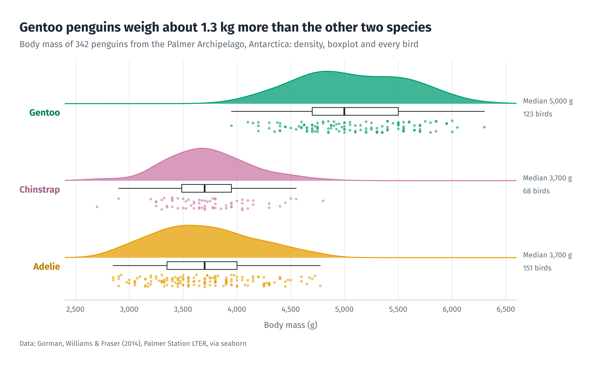</a><br><b>Raincloud plot</b><br>matplotlib, SciPy</td>
    <td width="33%" valign="top"><a href="charts/02_ridgeline_fuel_economy.py">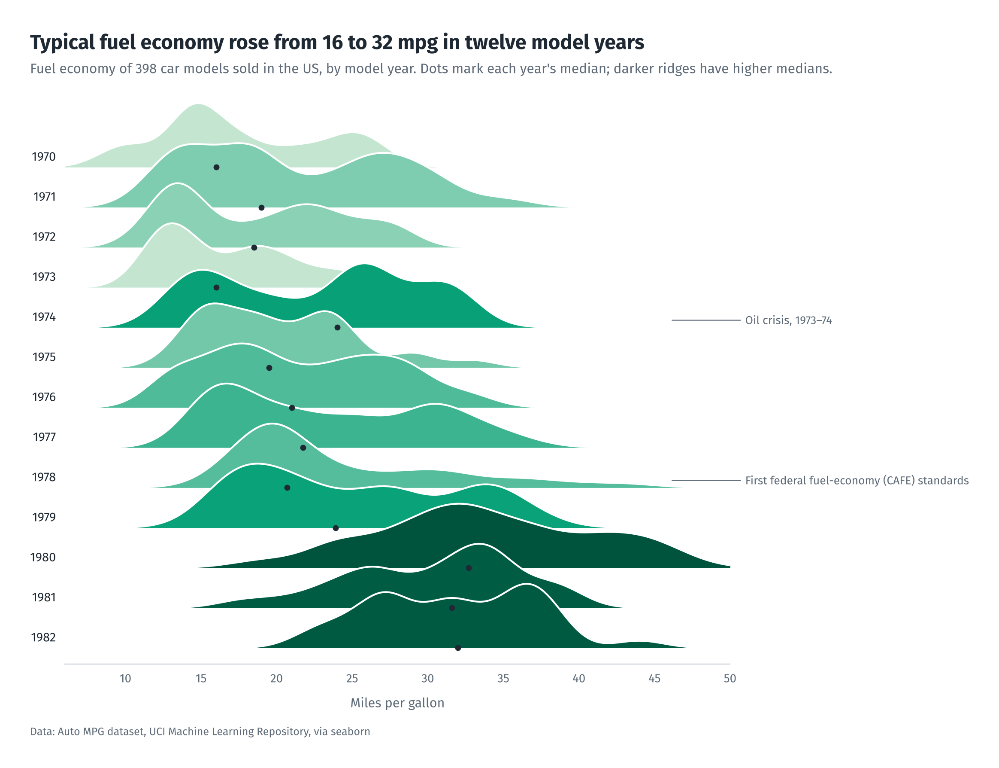</a><br><b>Ridgeline plot</b><br>matplotlib, SciPy</td>
    <td width="33%" valign="top"><a href="charts/03_simpsons_paradox_penguins.py">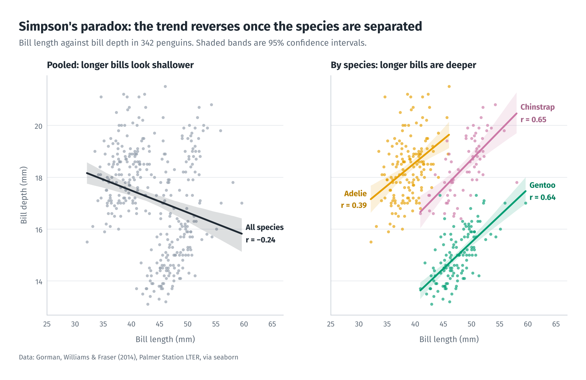</a><br><b>Simpson's paradox</b><br>seaborn</td>
  </tr>
  <tr>
    <td width="33%" valign="top"><a href="charts/04_hexbin_diamonds.py">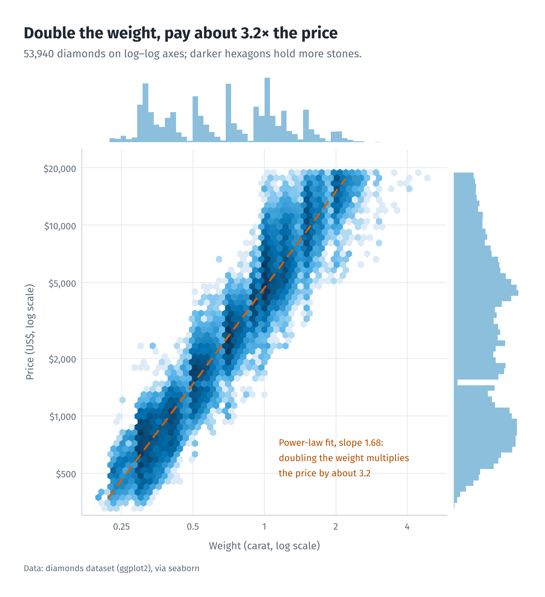</a><br><b>Hexbin with marginals</b><br>seaborn</td>
    <td width="33%" valign="top"><a href="charts/05_dumbbell_life_expectancy.py">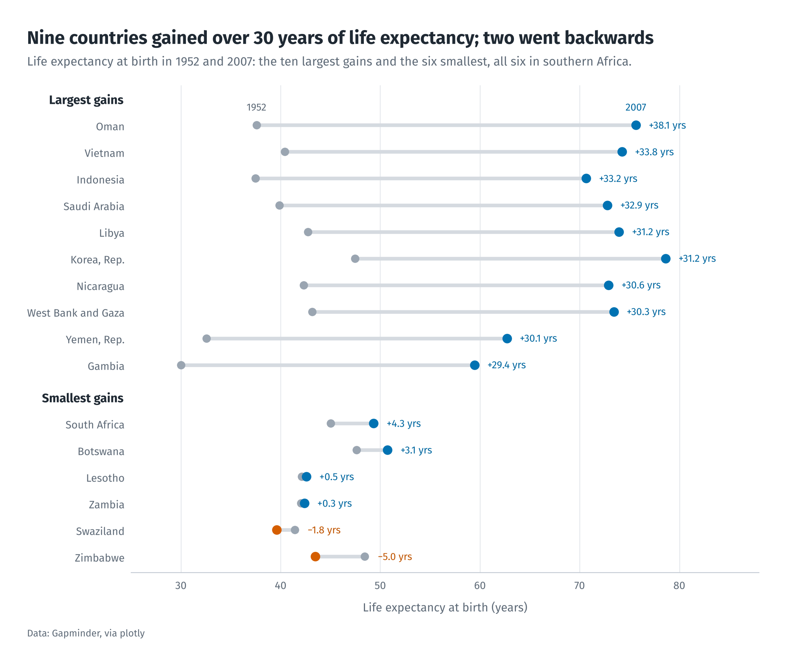</a><br><b>Dumbbell chart</b><br>matplotlib</td>
    <td width="33%" valign="top"><a href="charts/06_heatmap_air_passengers.py">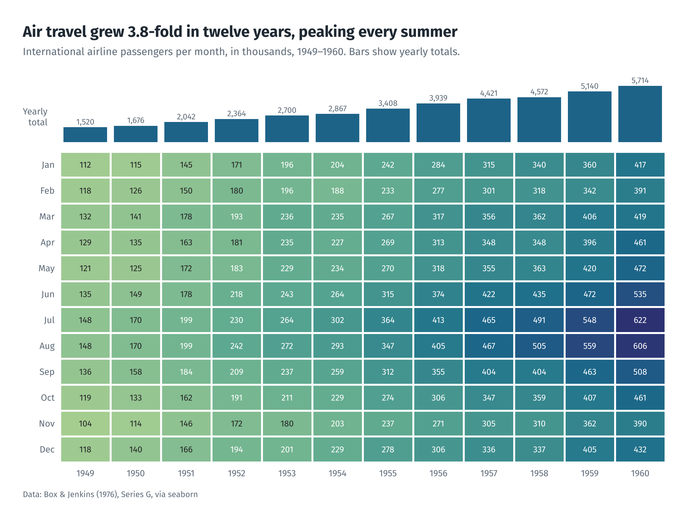</a><br><b>Annotated heatmap</b><br>seaborn</td>
  </tr>
  <tr>
    <td width="33%" valign="top"><a href="charts/07_sea_ice_extent.py">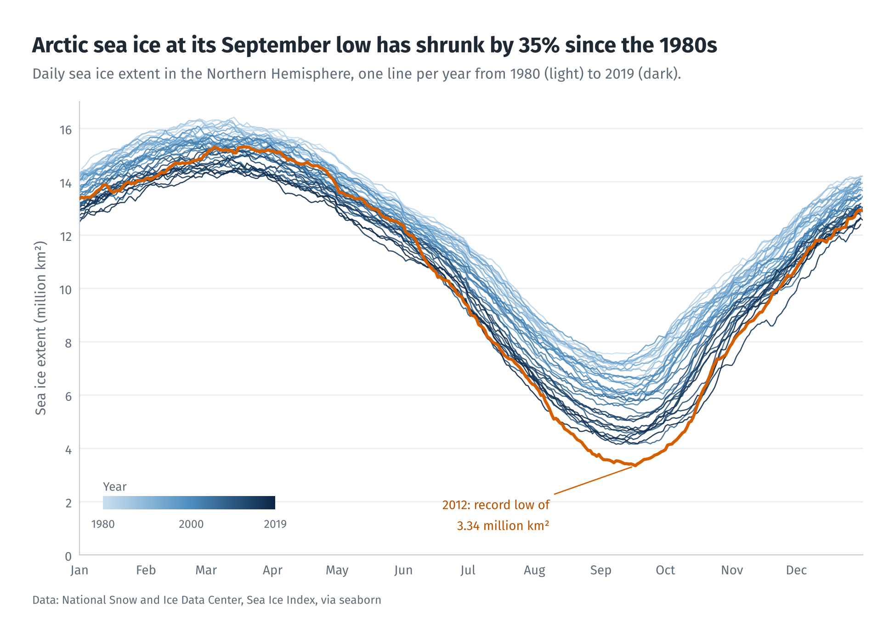</a><br><b>Highlighted time series</b><br>matplotlib</td>
    <td width="33%" valign="top"><a href="charts/08_animated_bubbles_gapminder.py">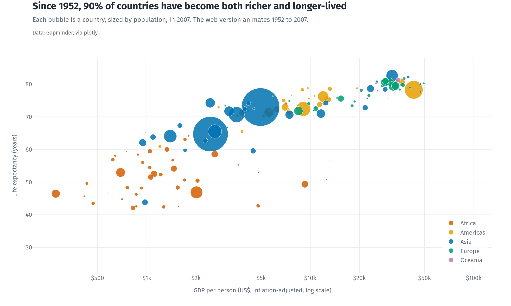</a><br><b>Animated bubble chart</b><br>plotly</td>
    <td width="33%" valign="top"><a href="charts/09_choropleth_life_expectancy.py">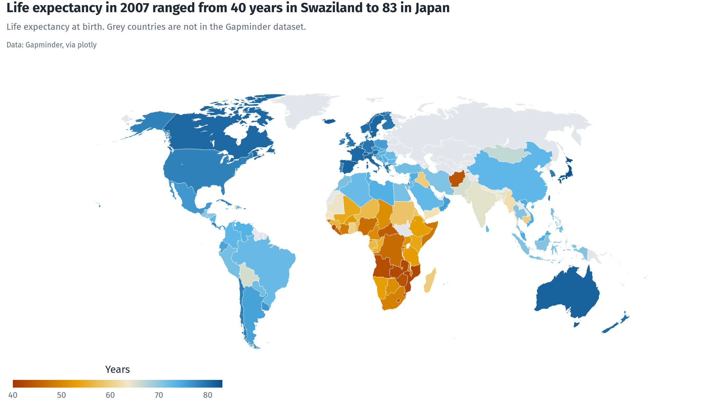</a><br><b>Choropleth map</b><br>plotly</td>
  </tr>
  <tr>
    <td width="33%" valign="top"><a href="charts/10_treemap_population.py">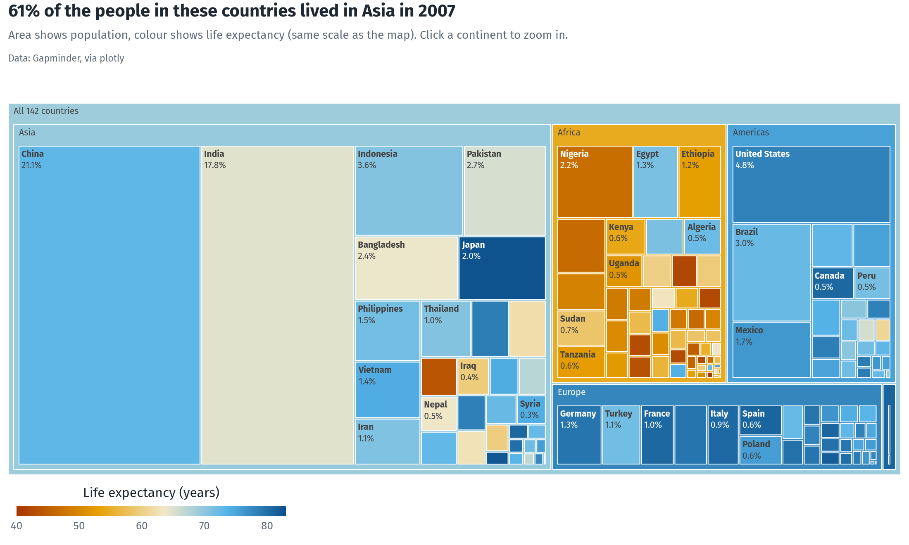</a><br><b>Treemap</b><br>plotly</td>
    <td width="33%" valign="top"><a href="charts/11_parallel_categories_titanic.py">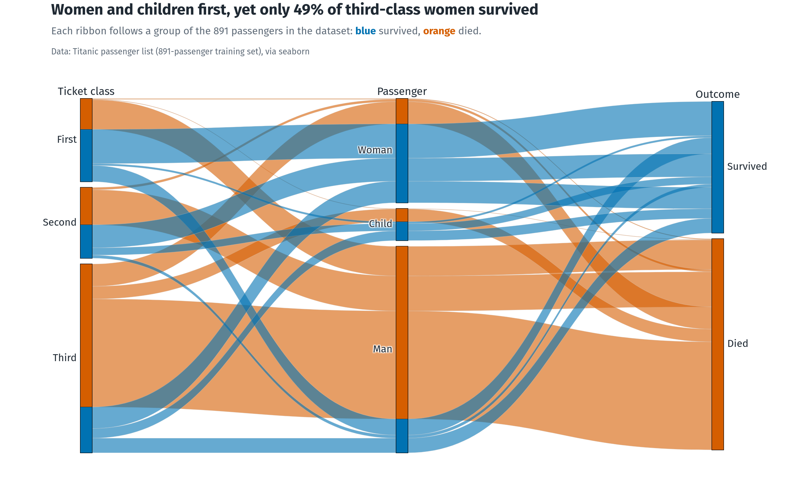</a><br><b>Parallel categories</b><br>plotly</td>
    <td width="33%" valign="top"><a href="charts/12_makeover_health_spending.py">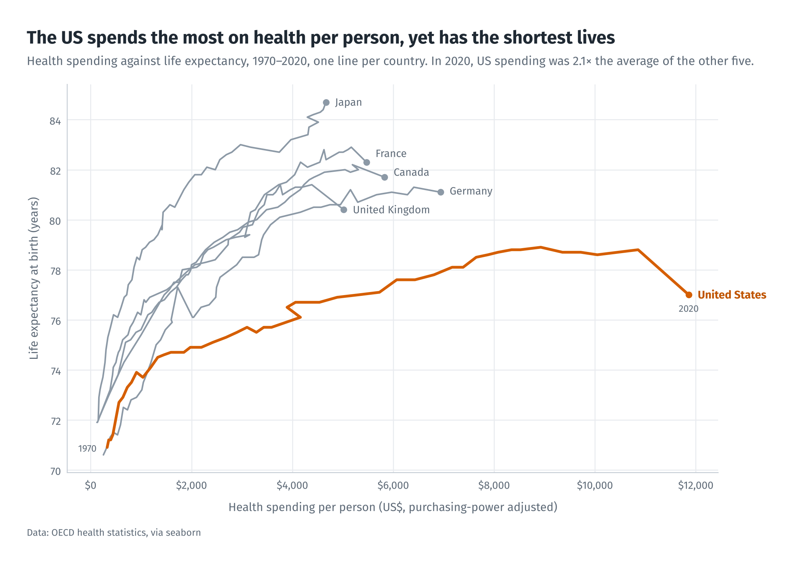</a><br><b>Before and after</b><br>matplotlib</td>
  </tr>
</table>

Each image links to the script that draws it.

## What each chart shows

| # | Chart | Question | Library | Worth a look |
|---|---|---|---|---|
| 01 | Raincloud plot | How heavy is each penguin species? | matplotlib, SciPy | Density, boxplot and raw points layered by hand |
| 02 | Ridgeline plot | How did fuel economy change through the 1970s? | matplotlib, SciPy | Overlapping densities, colour by median, notes on events |
| 03 | Simpson's paradox | Do penguins with longer bills have deeper bills? | seaborn | Paired panels, regressions with 95% intervals, direct labels |
| 04 | Hexbin with marginals | How does a diamond's price scale with its weight? | seaborn | 53,940 points binned on log-log axes, power-law fit |
| 05 | Dumbbell chart | Which countries gained the most life expectancy, and which the least? | matplotlib | Grouped rows, signed change labels, legend written into the chart |
| 06 | Annotated heatmap | How did air travel grow, month by month? | seaborn | Grid layout with a strip of yearly totals |
| 07 | Highlighted time series | How much Arctic sea ice is left at the summer low? | matplotlib | 40 years on one axis, inset colour bar, one year in focus |
| 08 | Animated bubble chart | Did countries become richer and healthier? | plotly | Animation frames, log axis, separate static export |
| 09 | Choropleth map | Where did people live longest? | plotly | Natural-earth projection, colour scale shared with chart 10 |
| 10 | Treemap | Where did people live, and how long? | plotly | Two-level hierarchy, population-weighted colour, click to zoom |
| 11 | Parallel categories | Who survived the Titanic? | plotly | Ordered categories, every path coloured by outcome |
| 12 | Before and after | Does spending more on health buy longer lives? | matplotlib | Redesign of a default chart, described below |

## Before and after

<table>
  <tr>
    <td width="42%" valign="top">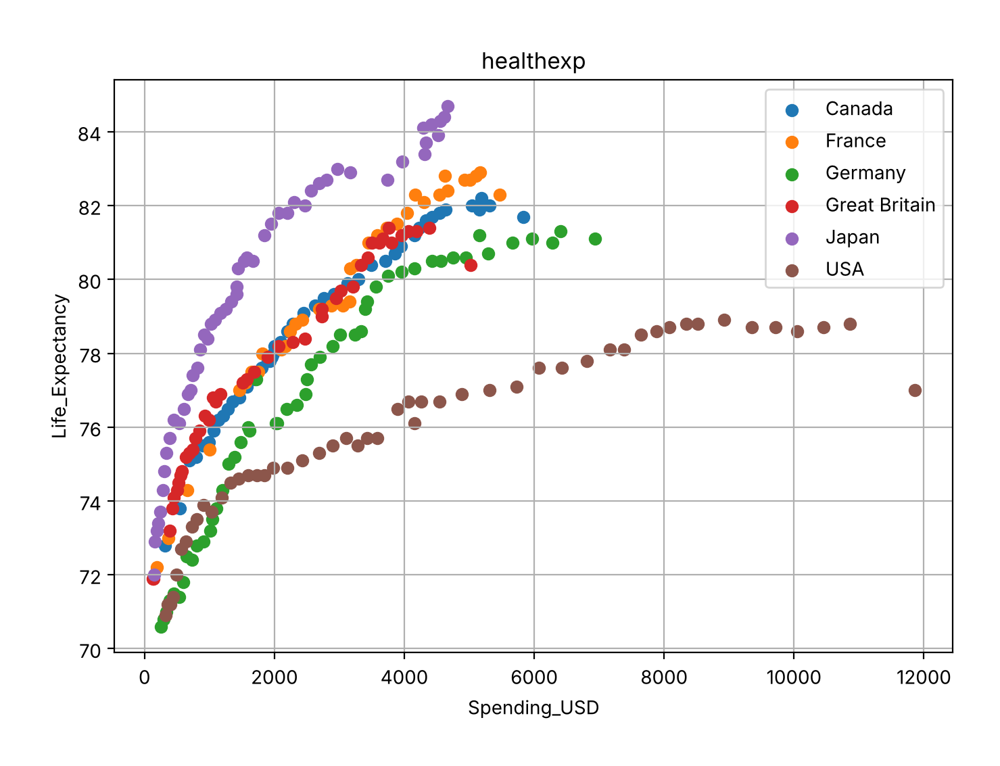<br>First draft, default settings</td>
    <td width="58%" valign="top"><br>Redesign</td>
  </tr>
</table>

Same data and the same question. What changed:

- The title states the finding instead of naming the dataset.
- Lines join each country's years, so its path over time is visible; loose dots hid it.
- One country is highlighted and the others become grey context, instead of six colours competing.
- Names sit at the end of each line, so there is no legend to decode.
- Axis titles are written for people, with units and thousands separators, and the source is credited.

## Design rules

Every chart follows the same few rules.

- **Colour:** the Okabe–Ito palette, which stays distinguishable for the common forms of colour blindness. Sequential scales are used only for ordered values.
- **Type:** Fira Sans, included in `fonts/` under the SIL Open Font License, so the figures look the same on any machine.
- **Words:** a headline that states the finding, a subtitle with the context, and a source line.
- **Ink:** light grids, no chart borders, and direct labels instead of legends where possible.

The matplotlib and seaborn style lives in `charts/portfolio.mplstyle`; the plotly template and the shared helpers are in `charts/_theme.py`.

## Rebuild everything

```bash
pip install -r requirements.txt
python make_all.py
```

This writes `figures/*.png` and the interactive pages in `docs/charts/`. The datasets download on first use through seaborn and plotly, and plotly's static images are exported with Kaleido.

## Repository layout

```
charts/        one script per chart, plus the shared theme and style
figures/       static PNG output, shown above
docs/          GitHub Pages site with the interactive charts
fonts/         Fira Sans and its licence
make_all.py    runs every chart script in order
```

## Data sources

| Dataset | Source |
|---|---|
| Palmer penguins | Gorman, Williams & Fraser (2014), Palmer Station LTER |
| Auto MPG | UCI Machine Learning Repository |
| Diamonds | ggplot2 example data |
| Airline passengers | Box & Jenkins (1976), Series G |
| Sea ice extent | National Snow and Ice Data Center, Sea Ice Index |
| Gapminder | gapminder.org |
| Titanic | 891-passenger training set |
| Health spending and life expectancy | OECD health statistics |

All datasets are loaded through seaborn or plotly.
